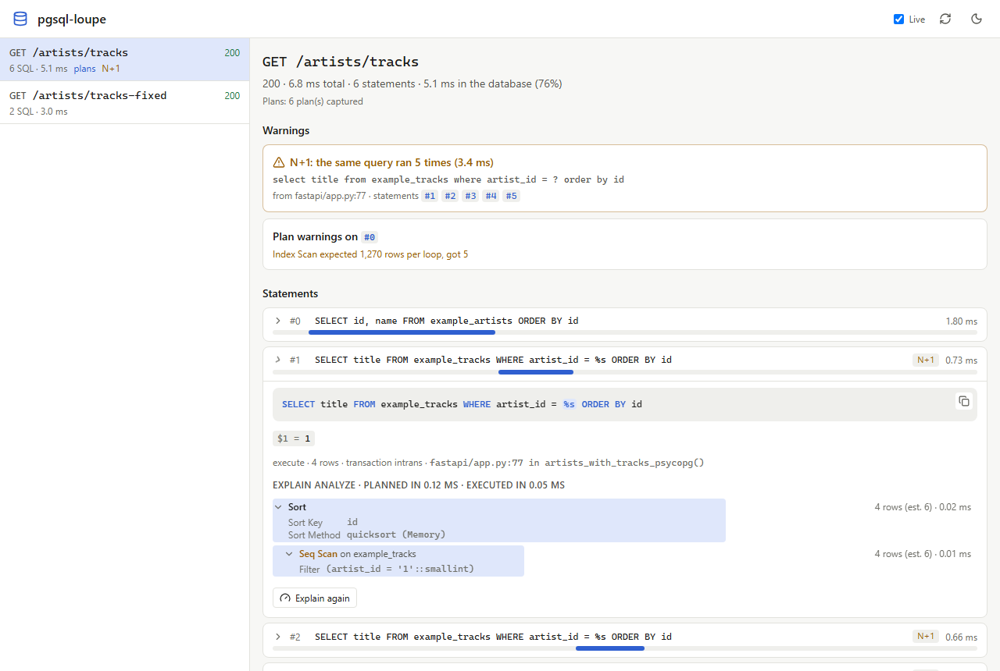

# pgsql-loupe

A debug panel for Python web apps on PostgreSQL. Open any page with `?lens=1` and see what it
did to the database: every statement, its parameters, how long it took, the line of your code
that ran it, `EXPLAIN ANALYZE` plans, the triggers that fired, and a warning when the same
query ran once per row.

## What it does

- **Records** every statement a request runs, through psycopg 3, SQLAlchemy 2 (sync and async)
  or asyncpg, without changing your queries.
- **Explains** them on request: analysed plans for reads, non-executed plans for writes, with
  fired triggers and warnings for big sequential scans, bad row estimates and spills to disk.
- **Warns** about N+1 patterns, duplicate queries and slow statements.
- **Shows** it all in a panel at `/__lens/` that ships inside the package (no Node needed).
- **Tests** it: a pytest fixture with `assert_max_queries`, `assert_no_nplus1` and
  `assert_no_seq_scan`.

## Safe by default

Off unless `PGSQL_LOUPE_ENABLED=1`, refuses to start when the environment says production,
answers only requests from this machine, and redacts parameters that look secret. Plan capture
never touches your connection and never runs a write unless you ask. See the
[safety model](safety.md).

## Next

- [Quick start](quickstart.md) for psycopg, SQLAlchemy or asyncpg.
- [How it compares](prior-art.md) with existing tools.
